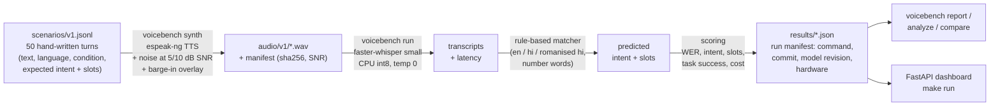

# VoiceBench

[](https://github.com/Sid13SST/VoiceBench/actions/workflows/ci.yml)

A small, reproducible evaluation harness for voice agents that serve
**Hindi, English and Hindi-English (code-switched)** callers, under
**background noise** and **interruptions**. It runs entirely on a CPU with
free, local tools: no API keys, no paid services.

It turns 50 versioned caller scenarios into synthetic audio, transcribes it
with a local Whisper model, extracts intent and slots with a rule-based
matcher, and reports WER, task success, latency and cost. Results are broken
down by language and condition, and a dashboard shows every failing case.

> **v0.1.0.** Every number in this README comes from a run file committed
> under [`results/`](results/README.md) and can be reproduced with the
> commands below. All benchmark audio is **synthetic** (espeak-ng). A
> separate [real-speech validation lane](#real-speech-check-whisper-small-on-human-hindi-fleurs)
> runs the same Whisper setup on 150 clips of human Hindi read speech
> (Google FLEURS). Please read [Limitations](#limitations) before drawing
> conclusions about real callers.

## Architecture



| stage | code | notes |
|---|---|---|
| scenarios | `scenarios/v1.jsonl`, `src/voicebench/schema.py`, `loader.py` | pydantic validation: intent belongs to its domain, allowed slots per intent, SNR only on noise scenarios, script check per language. Conventions in [`scenarios/README.md`](scenarios/README.md). |
| audio | `src/voicebench/audio/` | espeak-ng voices `en-us` and `hi`; seeded white / pink / babble noise mixed at an exact SNR (measured value stored per file); barge-in = caller over the agent prompt, which is 6 dB quieter. |
| ASR | `src/voicebench/asr.py` | faster-whisper `small`, deterministic decoding, language auto-detect or hint, one untimed warm-up call. |
| understanding | `src/voicebench/nlu/` | keyword scoring per domain intent, gazetteers, English + Hindi number words, last mention wins for self-corrections. |
| scoring & runs | `scoring.py`, `runner.py`, `report.py`, `analysis.py`, `compare.py` | corpus WER, task success = right intent **and** every expected slot; p50/p95 latency and real-time factor; failure categories. |
| dashboard | `src/voicebench/dashboard/` | task success by language × condition, case browser with word-level diff and audio, JSON API. Read-only. |

## Results: Whisper `small` on synthetic audio

From the day 5 runs (`make bench` and `make bench POLICY=hint`, commit
`20939304`, model `Systran/faster-whisper-small@536b066`):

| language | n | task success, auto-detect | task success, language hint | WER auto | WER hint |
|----------|---|---------------------------|-----------------------------|----------|----------|
| en       | 17 | 14/17 | 14/17 | 0.39 | 0.39 |
| hi       | 17 | 0/17  | 1/17  | 3.02 | 1.12 |
| hi-en    | 16 | 4/16  | 0/16  | 1.50 | 1.42 |
| **all**  | 50 | 18/50 | 15/50 | 1.63 | 0.97 |

| run | p50 latency | p95 latency | real-time factor p50 / p95 | wall time (50 clips, 198.9 s audio) | cost |
|-----|-------------|-------------|----------------------------|-------------------------------------|------|
| auto-detect   | 2886 ms | 11707 ms | 0.78 / 2.45 | 183 s | 0 USD |
| language hint | 2748 ms | 10968 ms | 0.79 / 2.08 | 177 s | 0 USD |

CPU only (4 vCPU Xeon @ 2.10 GHz, int8). WER is corpus-level after
lower-casing and removing punctuation, and can exceed 1 when the model adds
words. Cost is 0 USD because inference is local, with no per-call charge;
electricity and hardware are not counted.

The WER and latency figures above were measured on that original machine
and remain the documented baseline. A later run on a different machine
(Xeon @ 2.80 GHz, same model revision, same audio) reproduced task success
exactly (18/50 auto, 15/50 hint) but gave different WER and latency values:
all-clips WER 2.05 auto (documented 1.63) and 0.93 hint (documented 0.97),
p50 latency about 3.6 to 3.8 s (documented about 2.8 s). The cause of the
difference was not isolated.

### What failed

Full write-up: **[`docs/failure_analysis.md`](docs/failure_analysis.md)**
(counts reproducible with `voicebench analyze`).

- **Hindi: language ID fails before recognition does.** With auto-detect,
  none of the 33 Hindi or Hindi-English clips was identified as Hindi. They
  came out as `en`, `hu`, `ro`, `la`, `de` or `ja`; 30 of 33 transcripts are
  in Latin script. With the language given, all 33 are decoded as Hindi,
  but only 1 of 17 Hindi clips passes, and 24 failures contain no
  recognisable intent at all.
- **Code-switching: the language hint makes it worse** (4/16 → 0/16). Auto
  keeps English words like "cancel" and "password" in Latin script, which is
  enough for a few lucky passes. The hint writes them in Devanagari with
  non-standard spellings ("कान्सल", "त्रान्स्फर") that the matcher doesn't know.
- **Repetition loops cause the p95 latency.** In both runs the 4 slowest
  clips are ones where Whisper repeated itself ("may god be with you, may
  god be with you, …"). Loop clips have a median latency of about 11 s;
  every other clip finishes within 5.3 s.
- **English (14/17)**: three failures, each with a different cause. A
  10-digit PNR came out with only 8 digits. "From pune to mumbai" was lost in 5 dB
  babble. In a barge-in clip, the agent prompt and the caller mixed, and the
  matcher's tie rule chose the prompt's intent. One more barge-in clip
  (`v1-044`, "no just get me a human agent") passes although its transcript
  mixes the prompt and the caller: "Your call is important to us because we
  are human agents." The only intent keyword found is "human", from the
  caller's words; the prompt contributes neither "agent" nor "human", and
  "agents" does not match the keyword "agent".
- **Much of the synthetic Hindi failure is the synthetic audio.** On human
  Hindi speech (next section) the same model detects Hindi on 131 of 150
  clips (synthetic: 0 of 17) and reaches corpus WER 0.63 / 0.59 (synthetic:
  3.02 / 1.12). The two sets differ in text as well as voice, so this
  bounds the TTS effect rather than measuring it exactly.

## Real-speech check: Whisper `small` on human Hindi (FLEURS)

A validation lane separate from the benchmark: 150 clips of the Google
FLEURS Hindi test split (`hi_in`, CC BY 4.0), chosen with seed 20261031.
The clip list and reference transcripts are committed in
[`data/realspeech/`](data/realspeech/fleurs_hi_in_test_150.json); the audio
is downloaded at run time and never committed ([DATA_NOTES](DATA_NOTES.md)).
Same model, revision and decoding settings as the benchmark (CPU, int8,
beam 5, temperature 0). There are no intents here, so it measures
recognition only. Run files are in [`results/realspeech/`](results/README.md#real-speech-runs)
and shown in their own section of the dashboard.

| FLEURS hi_in, 150 clips, 3708 words | auto-detect | language hint (`hi`) |
|---|---|---|
| corpus WER | **0.631** | **0.593** |
| per-clip WER mean / median | 0.634 / 0.579 | 0.594 / 0.552 |
| clips with WER 0 / WER > 1 | 0 / 12 | 0 / 4 |
| detected language | hi 131, ur 15, ne 2, jw 1, id 1 | hi 150 (given) |
| repetition loops | 8 | 11 |
| reference numbers the matcher reads back | 6 of 34 | 7 of 34 |
| latency p50 / p95 | 7563 / 13760 ms | 6408 / 12572 ms |
| real-time factor p50 / p95 | 0.70 / 1.17 | 0.61 / 1.10 |
| wall time (1753 s of audio) | 1239 s | 1118 s |

Synthetic Hindi, for comparison (17 clips, same model): WER 3.02 auto /
1.12 hint, Hindi detected 0 of 17 times. Same machine type as the day 5
runs (Xeon @ 2.10 GHz, 4 vCPU). Reproduce with
`make realspeech-fetch && make realspeech && make realspeech POLICY=hint`
(about 20 minutes per policy on 4 CPUs), then
`voicebench realspeech report RUN` and `voicebench realspeech compare AUTO HINT`.

- **The hint changes only the misdetected clips.** For the 131 clips
  auto-detect labels Hindi, the two runs' transcripts are identical. The 19
  others (15 written in Urdu script, 2 labelled Nepali, 2 in Latin script)
  have WER 1.08 with auto-detect and 0.74 with the hint. Hindi and Urdu
  are one spoken language in two scripts, so `ur` is the main confusion.
- **Most errors are recognition errors inside Whisper `small`**: no clip
  is transcribed perfectly. Aspiration loss ("गंभीर" → "गंबीर", "था" →
  "ता") and short-for-long vowels account for 119 to 130 substitutions per
  run; numbers come out as misspelled Hindi number words ("उन्नीस सौ
  तिरसठ" for 1963 is written "उन्निस्स्सो तर्सट"), so only 6 or 7 of 34
  reference numbers can be read back. Repetition loops still occur (8 and
  11 clips) and are slow (median latency 12.3 / 11.8 s, against 7.3 /
  6.3 s for other clips).
- **One matcher fix came out of it**: Whisper drops the nukta from an
  otherwise correct word far more often than it keeps it (27 vs 5 times
  with auto-detect, 35 vs 7 with the hint), so the matcher now treats
  nukta and chandrabindu spellings as the same word. That doesn't change
  WER (the headline WER stays strict; folded, it is 0.622 / 0.582) or any
  synthetic result. Details: [`docs/failure_analysis.md`](docs/failure_analysis.md#real-speech-fleurs-hindi).

## Quick start

Requires Python 3.10+ and, to regenerate audio, `espeak-ng`
(`sudo apt-get install espeak-ng`).

```bash
make setup          # .venv with the package, dev and ASR extras
make setup-locked   # same, with the exact versions used for the committed runs (Python 3.11+)
make test           # with espeak-ng installed: 336 pass, 1 skipped (real-model test); without it 331 pass, 6 skipped (5 need espeak-ng); downloads no model
make validate       # check scenarios/v1.jsonl and print its makeup
make audio-check    # regenerate the audio in a temp dir and compare with audio/v1

make bench                 # full run, Whisper small, language auto-detect -> results/
make bench POLICY=hint     # pass the caller's language to Whisper
make run                   # dashboard at http://127.0.0.1:8000

make realspeech-fetch      # download FLEURS hi_in test (~250 MB) and extract the 150 manifest clips into .cache/
make realspeech            # real-speech lane, auto-detect -> results/realspeech/  (POLICY=hint for the hint)
```

`make bench` downloads the Whisper weights (~480 MB) from Hugging Face on
first use. `make bench MODEL=/path/to/ctranslate2-whisper-small` uses local
weights instead. A full run took 3 to 7 minutes on the 4-vCPU cloud machines used here.

Other commands (`.venv/bin/voicebench …`):

| command | what it does |
|---|---|
| `report RUN` | breakdown by language, condition, language × condition, with latency |
| `analyze RUN` | failure categories per language and condition, list of failed scenarios |
| `compare RUN_A RUN_B` | which transcripts and which pass/fail outcomes differ |
| `rescore RUN` | re-score saved transcripts with the current code (new run file, linked to the old one) |
| `run --asr oracle` | pipeline check with reference text as the transcript (not an ASR result) |
| `transcribe WAV…` | transcribe individual clips |
| `synth SCENARIOS --out DIR [--check]` | generate audio, or verify committed audio |
| `realspeech fetch` / `run` / `report RUN` / `compare A B` / `rescore RUN` | the real-speech lane: download clips, transcribe, WER / language / loop / latency / number report, auto vs hint comparison, re-score saved transcripts |

To score your own intent and slot extraction instead of the built-in
matcher, `run --understander package.module:function` imports a function
with the contract `understand(transcript, domain) -> {"intent", "slots"}`.
It runs trusted local Python code only. The contract, the Python-level
transcriber hook and their limits (built-in domains and intents only, no
HTTP) are in [`docs/ADAPTERS.md`](docs/ADAPTERS.md).

## Limitations

**The audio**
- **All benchmark speech is synthetic espeak-ng output**: one
  formant-synthesised (robotic-sounding) voice per language, with no
  accents, ages, genders or speaking styles. Nobody has listened to the
  clips to judge how intelligible the Hindi is.
- **Real-speech validation exists, for Hindi only.** On 150 FLEURS clips of
  human Hindi, Whisper `small` gives corpus WER 0.631 (auto-detect, Hindi
  detected on 131/150) and 0.593 (language hint), against 3.02 and 1.12 on
  the synthetic Hindi. That is read Wikipedia text, recorded wideband: not
  phone calls, not conversation, not code-switched. It checks recognition
  only (no intents), and its text differs from the scenarios, so it does
  not give task-success numbers for real callers. No openly licensed
  Hindi-English source could be verified, so code-switched results remain
  synthetic only ([why](DATA_NOTES.md#hindi-english-hinglish-not-added)).
- **Not telephone audio.** Clips are clean 16 kHz wideband. Real calls are
  usually 8 kHz narrowband with codec artefacts and packet loss; none of
  that is simulated.
- **Noise is synthetic** (white, pink, and babble made from other synthetic
  utterances). SNR is measured over the whole clip, including 250 ms of
  silence at each end.
- **Barge-in is simplified**: one mixed channel, the agent prompt keeps
  playing, and there is no echo cancellation. Self-correction exists only
  in the words.

**The measurement**
- **Small n**: 16 or 17 scenarios per language, as few as 3 per language ×
  condition cell. One scenario moves a cell by up to 33 points. No
  confidence intervals are reported, and they would be wide.
- **The matcher's lexicon was written alongside the scenarios.** It reads
  all 50 reference texts correctly by design. Scores show how much ASR
  errors break a matcher that understands the clean text, not how a real
  agent would cope with new callers. The matcher is also told the domain,
  and it breaks intent ties by list order (this decided one English
  failure, `v1-041`).
- **WER doesn't normalise numbers, script or spelling variants**: "5000" vs
  "five thousand", English words written in Devanagari, and "बड़ी" vs
  "बडी" count as errors. For the last one the real-speech report also
  gives a folded WER as a diagnostic.
- **Transcripts vary across CPUs.** Re-runs on one machine are identical.
  On another CPU, 22 to 33 of 50 transcripts changed (no pass/fail changed),
  so Hindi WER isn't stable across machines
  ([details](docs/REPRODUCING.md)).
- **Latency** is CPU-only, from one cloud machine, and times only the
  `transcribe` call. **Cost** excludes electricity, hardware and people.
- **One ASR model** and one decoding setup. Larger or India-focused models
  may do much better on Hindi; they haven't been tried.
- The optional spoof-risk adapter in the original plan was **not built**.
  It was out of scope until everything else was finished, and no suitable
  pretrained model was evaluated.

## Reproducibility and data

- [`docs/REPRODUCING.md`](docs/REPRODUCING.md): environment, exact commands,
  and what is and isn't reproducible. Audio regenerates byte-identically
  with espeak-ng 1.51 and numpy 2.5; CI checks this on every push.
- [`results/README.md`](results/README.md): provenance of every run file,
  including the day 4 re-score after a matcher fix and the same-machine
  re-run.
- [`DATA_NOTES.md`](DATA_NOTES.md): source and licence of every piece of
  data. Scenario text is hand-written and the benchmark audio is
  synthetic. The real-speech lane uses FLEURS Hindi (CC BY 4.0, with the
  attribution it requires); its audio is downloaded at run time, not
  committed. No scraped or real phone data.
- [`docs/progress.md`](docs/progress.md): day-by-day log, including what
  didn't work: blocked model downloads, a matcher bug found in real
  results, transcripts differing across CPUs, and one retracted claim.

## Licence

MIT, see [LICENSE](LICENSE). Whisper weights (MIT) are downloaded at run
time and not redistributed. The FLEURS clip list and transcripts in
`data/realspeech/` are CC BY 4.0 (attribution in [DATA_NOTES](DATA_NOTES.md)); FLEURS
audio is downloaded at run time and not redistributed. espeak-ng (GPL-3.0) is used as an external
program; the audio it generated is released here under MIT.
