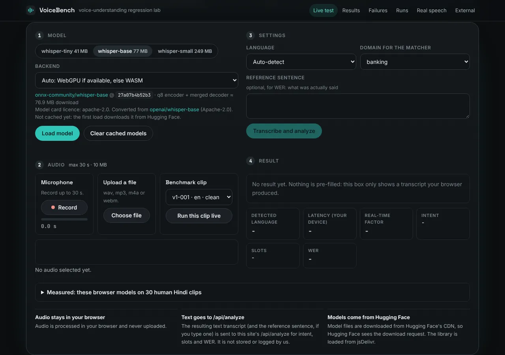
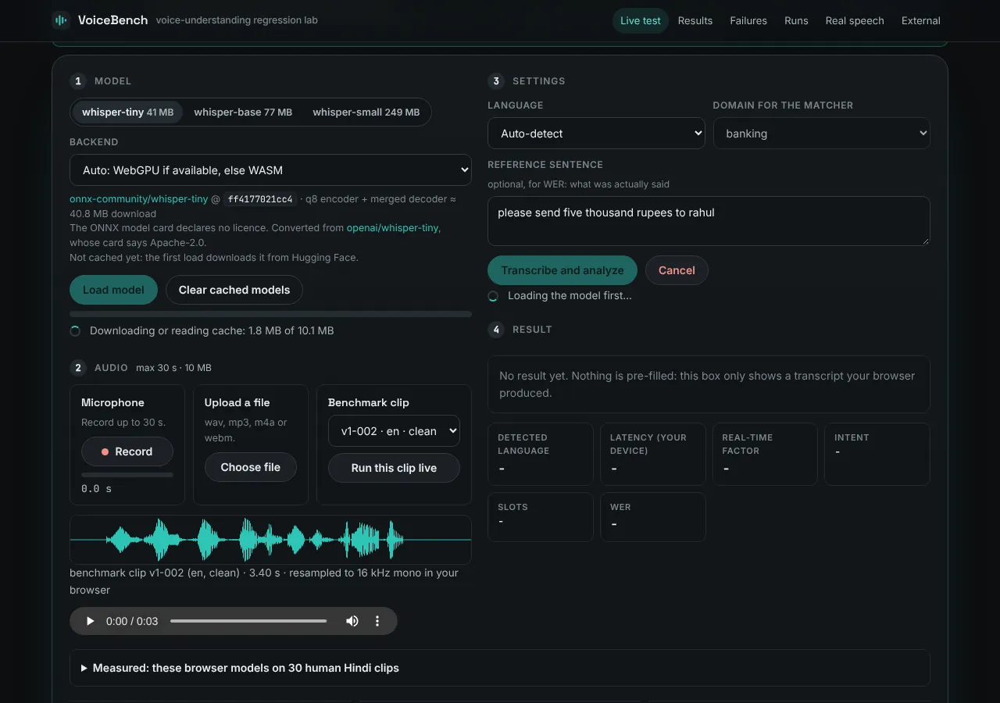
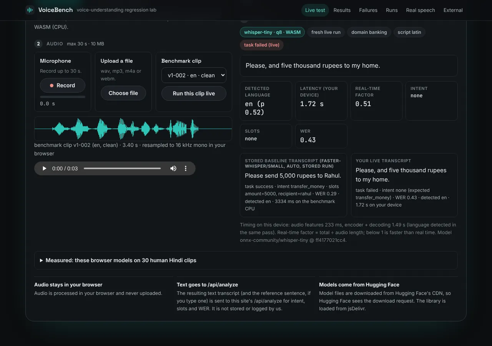
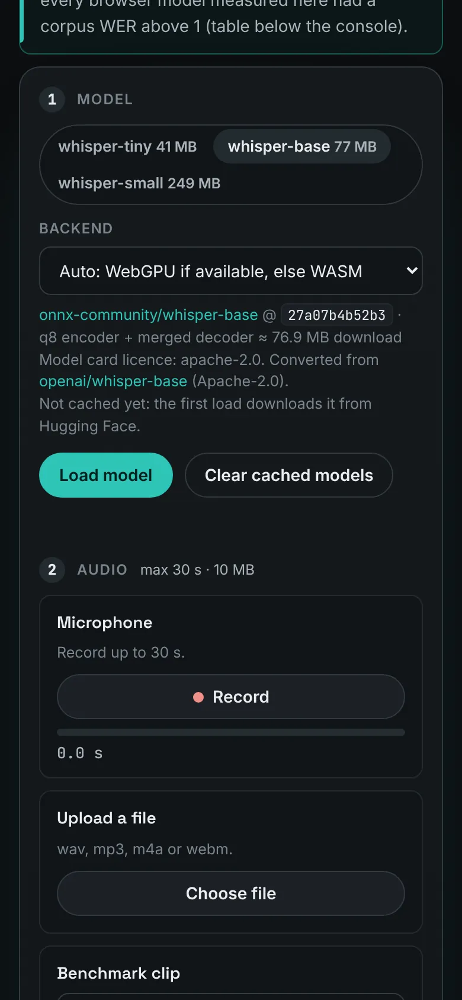
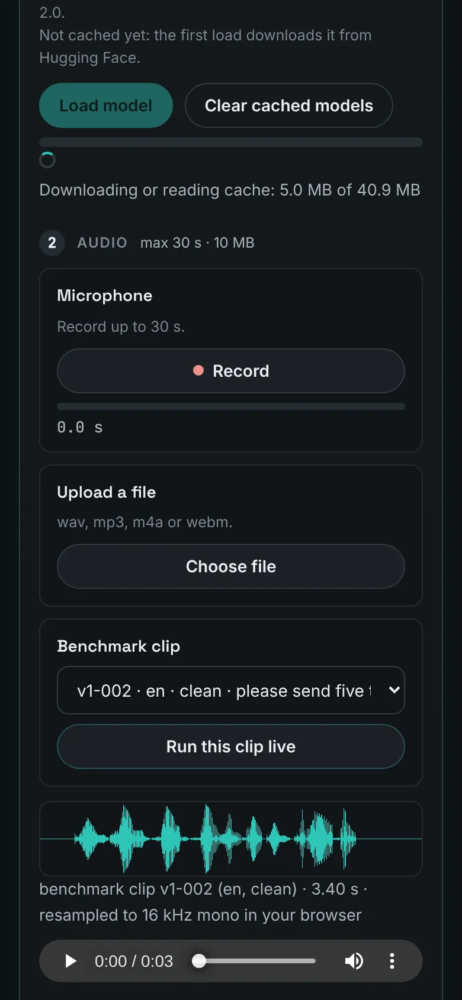
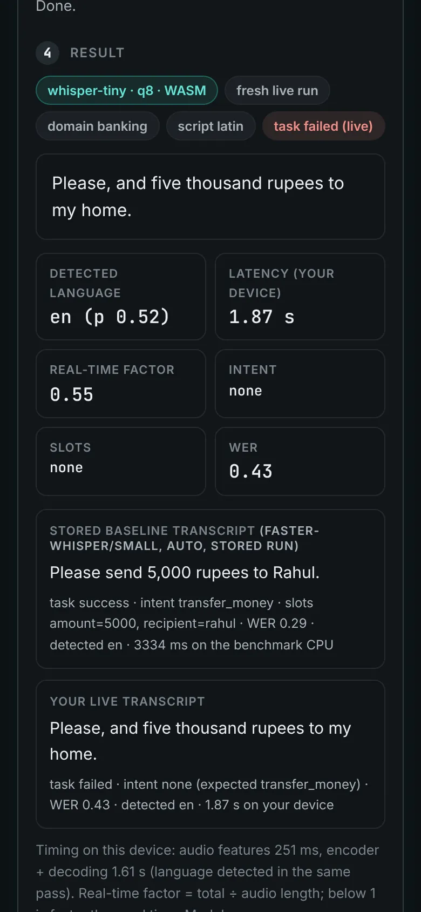

# Live test console

The first section of the dashboard lets a visitor test speech recognition and
the project's intent / slot matcher on their own device, with no account, no
key and no server-side model.

## What runs where

| step | where | code |
|---|---|---|
| record (MediaRecorder) or decode an upload, resample to 16 kHz mono | the visitor's browser | `static/live.js` |
| Whisper (encoder + merged decoder, q8 ONNX) | the visitor's browser, in a Web Worker, onnxruntime-web on WebGPU if the browser offers it, else WASM | `static/asr-worker.js`, transformers.js 4.3.2 |
| intent, slots, WER, task success | the dashboard's FastAPI function (`POST /api/analyze`) | `voicebench.nlu.matcher`, `voicebench.metrics`, `voicebench.scoring` |

**Privacy, exactly:** audio is processed in the browser and never uploaded.
The resulting text transcript (and the reference sentence, if the visitor
types one) is sent to this site's `/api/analyze` for intent, slots and WER;
it is not stored or logged by the app. Model files are downloaded from
Hugging Face's CDN, so Hugging Face sees the download request, and the
transformers.js library and the onnxruntime-web WASM binary are loaded from
jsDelivr. The page runs on the free tiers of Vercel and Hugging Face.

`/api/analyze` treats its input as untrusted: pydantic validates it (2000
characters at most per field, one of the four benchmark domains, no unknown
fields, no control characters, a 16 KB body cap), errors name the field but
never echo the text, and responses are `Cache-Control: no-store`. The page
renders transcripts, references and API answers with `textContent` only.

## Models

The browser loads these exact repositories and commits (`revision` is passed
to transformers.js, so a later push to the repo does not change what runs):

| model | ONNX repo @ revision | q8 encoder + decoder | licence on the ONNX model card | upstream weights |
|---|---|---|---|---|
| whisper-tiny | `onnx-community/whisper-tiny` @ `ff4177021cc41f7db950912b73ea4fdf7d01d8e7` | 40.8 MB | none declared | `openai/whisper-tiny` @ `169d4a43`, Apache-2.0 |
| whisper-base | `onnx-community/whisper-base` @ `27a07b4b52b3a4c5886134bb4320e93e1a4bbc7c` | 76.9 MB | apache-2.0 | `openai/whisper-base` @ `e37978b9`, Apache-2.0 |
| whisper-small | `onnx-community/whisper-small` @ `36050c46d777d46dc4b5f43f6d90574fc38f8732` | 249.1 MB | none declared | `openai/whisper-small` @ `973afd24`, Apache-2.0 |

Licences were read from each model card's metadata on Hugging Face; the
tiny and small ONNX cards carry no `license` field, so the page says so
rather than assuming one.

**Not the benchmark model.** The stored benchmark runs use faster-whisper
(CTranslate2, int8) on a server CPU. The console runs OpenAI's Whisper
weights converted to ONNX and quantised to 8 bits, in onnxruntime-web.
Decoding differs too: the console is greedy with no temperature fallback.
A live result is a fresh measurement on the visitor's device and is never
shown as, or merged into, the stored results.

**Language.** transformers.js 4.3.2 does not detect the language: with no
language it forces English. "Auto-detect" in the console therefore lets the
model pick the language token itself (the first decoding step may only
choose a language token, as Whisper's own `detect_language` does), then
forces `<|transcribe|><|notimestamps|>`, all in one pass. Because the q8
model quantises activations per call, this can give slightly different text
from passing the same language as a hint.

**Speed.** The app sends `Cross-Origin-Opener-Policy: same-origin` and
`Cross-Origin-Embedder-Policy: credentialless` (also set in `vercel.json`),
so the page is cross-origin isolated and onnxruntime-web can use WASM
threads (2 here). In the headless Chromium used for testing (4 cores),
one whisper-tiny encoder pass on clip v1-001 took 1.47 s without isolation
(1 thread) and 0.84 s with it.

## Measured on human Hindi speech

The same q8 models, through the dashboard's own `static/asr-worker.js`, in
headless Chromium (WASM, 4 CPU cores, cross-origin isolated, auto-detect) on
the first 30 clips (sorted by id) of the committed FLEURS hi_in dev split
(`data/realspeech/fleurs_hi_in_test_150_split.json`). WER is the project's
own `corpus_wer`. The last row is the stored benchmark run on the same clips.
Files: `results/browser-whisper/` (per clip, with transcripts) and
`tools/browser-whisper/` (scripts).

| system | corpus WER | detected hi | repetition loops | p50 / p95 time | RTF p50 / p95 | model load |
|---|---|---|---|---|---|---|
| onnx-community/whisper-tiny q8, browser WASM (4 cores, isolated=True) | 3.914 | 26/30 | 12 | 2.6 / 17.0 s | 0.29 / 1.97 | 6.4 s |
| onnx-community/whisper-base q8, browser WASM (4 cores, isolated=True) | 1.674 | 25/30 | 3 | 4.7 / 26.7 s | 0.56 / 2.39 | 6.5 s |
| onnx-community/whisper-small q8, browser WASM (4 cores, isolated=True) | 1.237 | 24/30 | 7 | 22.0 / 68.6 s | 2.18 / 5.6 | 14.4 s |
| stored run 20261031T200244Z-faster-whisper-small-realspeech-fleurs-hi_in-auto-rescored-9336d77 (faster-whisper/small, CTranslate2 int8, server CPU) | 0.680 | 24/30 | 1 | 6.3 / 12.0 s | - | - |

- WER above 1 means more inserted words than reference words, mostly from
  repetition loops (`voicebench.analysis.has_repetition_loop`).
- Times are wall-clock in the worker, from audio features to decoded text,
  on this sandbox's CPU; the visitor's device will differ. While the last 11
  whisper-small clips ran, the test suite and git also ran on the same
  machine, so its p95 may be slightly high.
- No model is claimed best for Hindi; these are 30 clips, read speech only.
- A throttled-CPU timing was attempted with Chrome DevTools'
  `Emulation.setCPUThrottlingRate` (4x): times did not change (2056 to
  2148 ms on the first clip), because that throttling applies to the page,
  not to the Web Worker that runs the model. No throttled number is reported.

## How it was tested

- `pytest`: the whole suite, including `tests/test_live.py` (pure-function
  tests of `analyze()` against `match`, `wer` and `scoring.score`; input
  validation; `/api/analyze` status codes, no echo of rejected text,
  `no-store`; `/api/clips` against the stored run file; page order and the
  privacy and caveat wording; isolation headers).
- Real headless Chromium (Playwright) against `uvicorn app:app`, with model
  files downloaded live from Hugging Face. jsDelivr is blocked in the
  sandbox, so the test harness served the identical files from the npm
  tarballs of `@huggingface/transformers@4.3.2` and
  `onnxruntime-web@1.31.0-dev.20260914-8d85527a0` in its place; in
  production the browser fetches them from jsDelivr.
- Checked: benchmark clip live (load, progress, result, comparison with the
  stored baseline), mp3 and m4a upload, a 35 s file (over-limit error), a
  `.txt` file (type error), microphone with Chromium's fake device, cancel
  while loading (error with retry). Layout at 390 px (phone emulation) and
  1280 px: no horizontal overflow.
- Not checked: WebGPU (headless Chromium here has no GPU adapter, so the
  WASM path ran), a real microphone, Safari and Firefox, and a deploy on
  Vercel itself.

## Screenshots

Idle, downloading and with a result (whisper-tiny on benchmark clip v1-002), at 1280 px and 390 px:

| idle | downloading | result |
|---|---|---|
|  |  |  |
|  |  |  |
